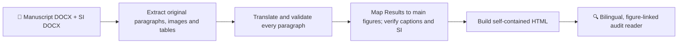

<div align="center">

# 📖 paper-bilingual-figure-audit

**A bilingual, figure-linked scientific manuscript reader — full Traditional Chinese translation above the original English, with main figures and Supporting Information always within reach.**

[English](README.md) · [繁體中文](README.zh-TW.md)


</div>

---

## ✨ What it does

A reusable workflow for researchers reviewing English manuscripts and Supporting Information (SI). It transforms source material and a **verified, complete** paragraph-by-paragraph translation into one offline HTML reader rather than forcing readers to jump between a Word document, a translated draft, and dozens of supplementary images.

| Reader feature | Behavior |
| --- | --- |
| **Full bilingual paragraphs** | Traditional Chinese first; the **verbatim English source directly beneath**, visible by default. |
| **Figure-aware navigation** | Group long Results and discussion sections around the corresponding main figures. |
| **Compact source locators** | `Introduction · P2`, `Fig. 3 · P2`, `Experimental section — Electrochemical Characterization · P2`, `Fig. 1 caption`. |
| **Main + SI evidence** | Original figure images, bilingual captions, SI tables, and links from every relevant manuscript paragraph. |
| **Interactive audit** | Search, figure zoom, previous/next controls, pin-and-compare, and paragraph notes with Markdown export. |
| **Offline handoff** | A single HTML file with embedded images, styles, scripts, and manuscript data; no CDN dependencies. |
| **Quality gates** | Check translation coverage, figure/caption matching, equations, units, references, and table values. |

> **Important:** The Python tools extract DOCX text and figures and assemble the HTML. **They do not automatically translate the manuscript.** A language model or translator must fill and verify every Chinese paragraph. Caption-to-image matching from Word is *tentative until visually checked*.

## 🧭 How the workflow fits together



## 🏗️ Installation and usage

### ChatGPT or an AI project workspace

Add [`SKILL.md`](SKILL.md) to your project files / custom instructions, or install the skill if your workspace supports installing skills. Ask the assistant to read it before processing the manuscript. The model still needs access to the manuscript and SI files.

**Example prompt:**

> Use `paper-bilingual-figure-audit` to translate this manuscript and its Supporting Information into complete Traditional Chinese and produce a single offline bilingual HTML reader. Keep the English immediately below each Chinese paragraph. Link Fig. 1–N, Fig. S1–N and SI tables, and report any missing content.

### Build locally with Python

Requirements: **Python 3.10+**, plus **`python-docx`** for DOCX extraction. Building the HTML needs only Python's standard library.

```bash
python -m pip install python-docx
python scripts/extract_docx.py manuscript.docx --role ms --out work/ms.json --assets work/ms-images
python scripts/extract_docx.py supporting.docx --role si --out work/si.json --assets work/si-images
```

The extracted JSON is an **English-only skeleton**. Translate and cross-check **all** source blocks, verify the images and tables, and merge the content into `filled_translation.json` according to [`references/reader-json-spec.md`](references/reader-json-spec.md). Then:

```bash
python scripts/build_reader.py filled_translation.json -o paper_bilingual_reader.html
```

Run the included *generic, non-confidential* demo:

```bash
python scripts/build_reader.py examples/demo_reader.json -o demo.html
```

Preview the packaged [example output](examples/demo_output.html) or the [generic demo illustration](assets/demo-figure.svg). The demo is illustrative; it contains **no submitted manuscript or unpublished experimental results**.

## 📁 Repository layout

```text
paper-bilingual-figure-audit/
├── SKILL.md                      # Trigger conditions, translation rules, QA requirements
├── README.md                     # English guide (this file)
├── README.zh-TW.md               # 繁體中文使用說明
├── scripts/
│   ├── extract_docx.py           # Extract DOCX paragraphs, image assets, tables
│   └── build_reader.py           # Assemble translated JSON into offline HTML
├── references/
│   ├── reader-json-spec.md       # Input schema and figure/paragraph mapping
│   └── reader-template.html      # HTML/CSS/JS presentation template
├── examples/
│   ├── demo_reader.json          # Fictional, fully translated input example
│   └── demo_output.html          # Rendered demo file
└── assets/
    └── demo-figure.svg           # Generic demonstration visual
```

## 🔎 Source locator conventions

| Source context | Reader label |
| --- | --- |
| Second Introduction paragraph | `Introduction · P2` |
| Second paragraph related to main Fig. 3 | `Fig. 3 · P2` |
| Second Electrochemical Characterization paragraph | `Experimental section — Electrochemical Characterization · P2` |
| Figure 1 caption | `Fig. 1 caption` |
| Supporting Figure 2 caption | `Fig. S2 caption` |
| Supporting Table 1 caption | `Table S1 caption` |

`P` abbreviates *paragraph*. Results and discussion is grouped for **navigation**; figure group headings are not represented as original manuscript section titles. Figure captions are **not** counted as Results paragraphs.

## 🔐 Accuracy and privacy

- Never publish proprietary/unsubmitted manuscripts, sample translations or extracted original figures to a public repository without permission.
- Retain all original figures, numerical values, equations, electrode conditions and citations **unchanged**. Show questionable claims separately instead of silently correcting them.
- Some OOXML equations, floating images and merged tables need extra inspection after extraction.
- Verify `Fig.` / `Fig. S` / `Table S` cross-references and compare HTML with the source before reporting full coverage.
- Preserve original reference entries; optional translated titles are supplemental.

## 📜 License and acknowledgments

This skill is distributed as part of the parent repository under its existing license. The reader sample files are synthetic and do not contain confidential scientific material.